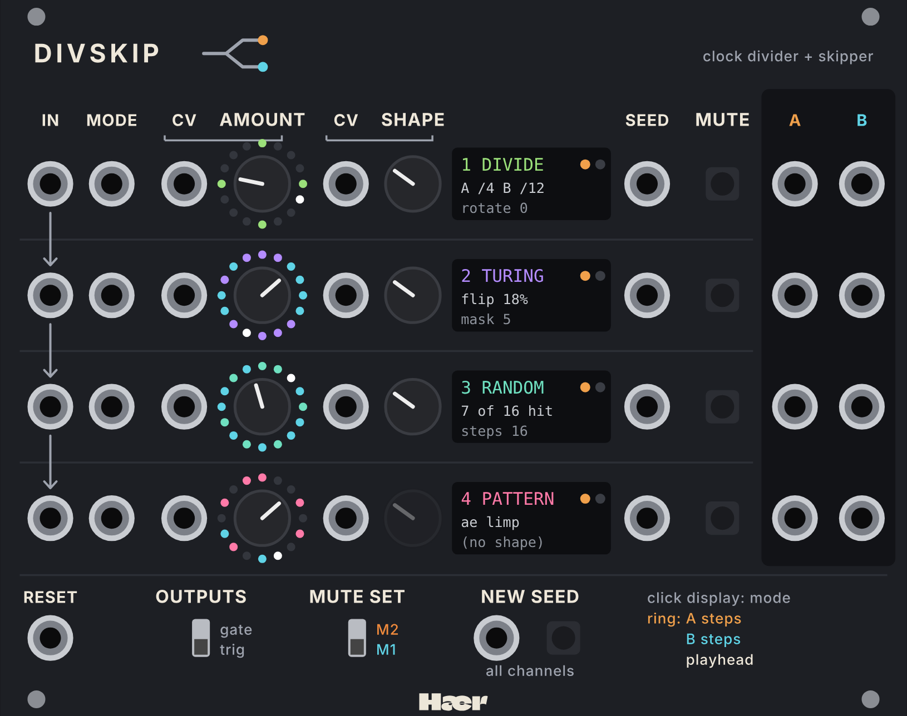

# Divskip

A VCV Rack module by Haer (32 HP). Four channels. Each one takes a clock (or
any triggers) and splits it between two outputs, **A** and **B**: the hits that
play and the hits that are skipped. Inspired by the DivSkip Eurorack module by
DivKid and Making Sound Machines; this is an independent VCV version with its
own panel, drum patterns and a few extras.



## Each channel

| Part | What it does |
|---|---|
| **IN** | Clock or triggers. An empty IN uses the channel above, so one clock in channel 1 drives all four. |
| **MODE** (jack) | Moves the mode on: each +1 V is one mode further (wraps round). Good for a sequencer. |
| **CV** + **AMOUNT** | The mode's main setting (below). CV is ±5 V, added to the knob (the knob spans 0 to 5 V). The light ring shows the steps: A steps in the mode's colour, B steps cyan, playhead white. |
| **CV** + **SHAPE** | The mode's second setting (below). Each mode remembers its own SHAPE position, so switching mode brings back that mode's setting; double-click resets it to that mode's default. Dimmed in modes that don't use it. |
| **Display** | Mode, AMOUNT and SHAPE in words. **Click** = next mode, **Shift-click** = previous, **Ctrl/Cmd-click** = new seed for this channel, **right-click** = mode list and Chain. |
| **SEED** (jack) | A trigger gives this channel a new seed (COIN, TURING, RANDOM, STICKY). |
| **MUTE** | Silences A and B (the channel keeps counting). |
| **A / B** | The two outputs, 10 V. |

## Modes

| # | Mode | AMOUNT | SHAPE (default) |
|---|---|---|---|
| 1 | **COIN** | Each hit goes to A or B at random. Left = always A, noon = 50/50, right = always B. | Loop: off, 4, 8, 16, 32 steps (16). Looped, the same coin tosses repeat; AMOUNT still tips them. |
| 2 | **DIVIDE** | Clock divider on A and B, lengths add up to 16. Noon = /8 and /8, left = /1 and /15, right = /15 and /1. | Rotate both by 0–15 steps (0). |
| 3 | **TURING** | A looping random pattern (set steps → A, unset → B). Left half: loop length 1–16, locked. Right half: 16 steps, more and more likely to change. Full left = always A. | Mask: a second random loop of 0 (off) to 8 steps; where it's off, A and B are both silent (0). |
| 4 | **SPLIT** | Euclid split: A plays 3 hits over its part of 16, B plays 3 over the rest. Noon = 3:3:2 on both. | not used |
| 5 | **EUCLID** | Loop length, 1–16 steps. A plays the hits, B the gaps. | Number of hits (3). |
| 6 | **RAMP** | Each clock becomes a run of hits (alternating A, B) that speed up (left), speed up then slow (noon) or slow down (right). In gate mode: a gate on A, then one on B, length set exponentially. | Number of hits, 1–16 (16). |
| 7 | **RATCHET** | Each clock becomes a burst: A gets *n*, B gets 16 − *n* evenly spaced hits. In gate mode: A/B gate lengths in fine, even steps. | Divide the clock first: off, /2, /4, /8 (off). A divided burst spreads over the longer time. |
| 8 | **PATTERN** | 24 four-bar drum patterns per channel, from a 16th-note clock. Ch 1 kick/snare, ch 2 closed/open hat, ch 3 low/high perc, ch 4 ride/accents. | not used |
| 9 | **RANDOM** | How many of the steps hit; the hits sit in random places. Turning it adds or removes one hit at a time. | Number of steps, 1–32 (16). |
| 10 | **STICKY** | Sticky coin: how likely each hit is to go to the same output as the last. Left = swaps every hit, noon = coin toss, right = long runs. | Loop: off, 4, 8, 16, 32 steps (off). |

RAMP and RATCHET fit their hits into the time between your last two clocks.

## Chain

Right-click a channel's display (or the module) and tick **Chain to channel above**.
Chained channels play one after another as one long loop: channel 1 plays its loop
once, then channel 2 plays its loop, and so on, then back to channel 1. Each
channel keeps its own mode and setting, so a chain can be 16 RANDOM steps then a
TURING loop of 7, for instance. A loop is 16 clocks, or the TURING / EUCLID / RANDOM length, or the COIN / STICKY loop length when one is set.

- The whole chain runs on the top channel's clock.
- The **top channel's A and B send the whole chain**. Each other channel's A and B
  send only its own turn, so you can still give each part its own sound.
- A display linked by a bar on its left is chained; it dims while waiting its turn.

## Global

- **OUTPUTS**: *trig* sends 5 ms triggers. *gate* holds each output high until the next clock, so two A steps in a row give one long gate.
- **MUTE SET**: two sets of mutes, M1 (cyan) and M2 (orange). Flip the switch to jump between two mute scenes.
- **NEW SEED** button and jack: a new seed for every channel that is in COIN, TURING, RANDOM or STICKY (new coin/sticky loops, new Turing loop and mask, new random pattern with the same number of hits). Seeds are saved with the patch.
- **Gate gap** (right-click the module): in gate mode, gates end 2 ms before the next clock, so two A steps in a row are two gates instead of one long one.
- **RESET**: all channels back to step 1. A channel also goes back to step 1 by itself after 3 seconds without a clock.

## Building

```
python3 tools/make_patterns.py   # drum patterns -> src/DivskipPatterns.hpp
python3 res/make_panel.py        # panel -> res/Divskip.svg (needs fonttools + Inter)
c++ -std=c++11 -O2 -Wall -Wextra -o test/engine_test test/engine_test.cpp && test/engine_test
make dist RACK_DIR=...           # or let GitHub Actions build it
```

The version stays 2.x: Rack 2 skips plugins numbered 3.x.

## Licence

MIT (see `LICENSE.txt`): you're free to use, change, port (VST/CLAP, other platforms, hardware) and share this code, as long as the copyright notice and licence text come along. Fonts on the panel (Inter, Climate Crisis) are under the SIL Open Font Licence.
